# AURELIA FC — Database

MySQL 8.0 schema for the AURELIA FC Web Forms site.

- **Database name:** `aurelia_fc_v2`
- **Storage engine:** InnoDB
- **Character set / collation:** `utf8mb4` / `utf8mb4_unicode_ci`
- **Tables:** 34 base tables + 2 views
- **Referential integrity:** 17 foreign keys

The original `aurelia_fc` database is left untouched. The application points at
`aurelia_fc_v2` through the connection string in `AureliaFc.Web/Web.config`.

## Files

| File | Purpose |
| --- | --- |
| `schema.sql` | Drops and recreates `aurelia_fc_v2`, creates every table, index, constraint and view. |
| `data.sql` | Seed / reference data (players, fixtures, products, news, demo users, ...). Load after `schema.sql`. |
| `setup.cmd` | Windows one-shot: runs both scripts above with the right character set. |
| `setup.sql` | Same, for MySQL command-line clients that support `SOURCE`. |

## Setup

### Windows (recommended)

```bat
cd webforms\database
setup.cmd "C:\path\to\mysql.exe"
```

If `mysql.exe` is on `PATH`, just run `setup.cmd`.

The client connects as `root` with no password by default. For any other account,
set `MYSQL_PWD` (password) and edit the `-u` flag in `setup.cmd`.

### MySQL command line

```bat
mysql -u root -h 127.0.0.1 --default-character-set=utf8mb4 < schema.sql
mysql -u root -h 127.0.0.1 --default-character-set=utf8mb4 < data.sql
```

### MySQL Workbench

Open `schema.sql`, execute the whole script, then open `data.sql` and execute it.
`setup.sql` uses `SOURCE`, which Workbench does not support.

## Connecting the application

`AureliaFc.Web/Web.config`:

```xml
<add name="Aurelia"
     connectionString="Server=127.0.0.1;Port=3306;Database=aurelia_fc_v2;User=root;Password=;SslMode=None;AllowUserVariables=True;CharSet=utf8mb4;"
     providerName="MySql.Data.MySqlClient" />
```

`DAL/AureliaDatabase.cs` resolves the connection string in this order:

1. `ConnectionStrings__Aurelia` environment variable
2. `AURELIA_CONNECTION_STRING` environment variable
3. the `Aurelia` entry in `Web.config`

Credentials are never committed for production; set either environment variable on
the host instead of editing `Web.config`.

## Design conventions

- **Surrogate primary keys.** Every table has an `id` (`INT UNSIGNED` or
  `BIGINT UNSIGNED` for high-volume logs) with `AUTO_INCREMENT`.
- **Natural keys are protected.** `users.email`, `news_articles.slug`,
  `orders.reference`, `products`/`news` slugs, `competitions(name, season)`,
  `players(team_id, squad_number)` and similar are `UNIQUE`.
- **Relationships are enforced.** Player → team/position, match → competition,
  ticket fixture → match, order item → order, order → user, news tag → article,
  contact message → user, password reset → user all carry real foreign keys with
  deliberate `ON DELETE` rules (`CASCADE` for owned children, `SET NULL` for
  optional references).
- **Only facts are stored.** `league_standings` keeps played/won/drawn/lost/goals
  and nothing else — goal difference and points are derived in
  `vw_league_table` and in `DAL/MatchRepository.cs`. `CAST(... AS SIGNED)` is
  required there because the goal columns are `UNSIGNED`.
- **Domain integrity in the database.** `ENUM`s for statuses (`matches.status`,
  `orders.status`, `order_items.item_type`, `users.role`) and `CHECK`
  constraints (non-negative prices, `order_items.quantity > 0`) reject bad rows
  even if a future caller bypasses the repositories.
- **Indexes match the queries.** Listings (featured/latest news, fixture order,
  squad numbers, order history, unhandled messages) are covered by composite
  indexes rather than a single-column index per flag.
- **Money is `DECIMAL`**, never float. Prices are stored in pounds with two
  decimal places; `orders.total_amount` is the authoritative total and each
  `order_items` row keeps `unit_price` at the time of purchase.

## Tables

**Club & content**

| Table | Row meaning |
| --- | --- |
| `club_info` | Single row of club identity (name, motto, stadium, capacity). |
| `club_milestones`, `club_values`, `club_honours` | About-page content, ordered by `sort_order`. |
| `club_executives` | Board / staff profiles. |
| `faqs`, `partners`, `quick_links` | Footer and help content. |
| `contact_departments` | Contact addresses shown on the Contact page. |
| `contact_messages` | Contact-form submissions (`is_handled` for triage). |

**Squad**

| Table | Row meaning |
| --- | --- |
| `teams` | First team, U21, U18, ... |
| `positions` | Goalkeeper, Defender, Midfielder, Forward. |
| `players` | Squad member; unique `(team_id, squad_number)`. |
| `player_season_stats` | Month-by-month stats per player. |
| `player_career_history` | Previous clubs listed on the profile page. |

**Matches**

| Table | Row meaning |
| --- | --- |
| `competitions` | League / cup, unique `(name, season)`. |
| `matches` | Fixture or result, `status` drives Upcoming/Result rendering. |
| `match_events` | Goals, cards, substitutions, ordered by `minute`. |
| `match_lineups` | Formation and starting XI per side. |
| `match_stats` | Possession, shots, etc. per match (`stat_label` unique per match). |
| `league_standings` | One row per club per competition; unique `(competition_id, position)`. |

**Tickets & shop**

| Table | Row meaning |
| --- | --- |
| `ticket_fixtures` | Match made available for ticket sales, one row per match. |
| `season_ticket_tiers`, `season_ticket_features` | Season-ticket products and their benefit lists. |
| `hospitality_packages` | Hospitality products. |
| `product_categories`, `products` | Club-shop catalogue. |
| `orders`, `order_items` | Purchases; `order_items.item_type` + `item_ref_id` reference the catalogue row, and prices are re-read server-side before insert. |

**Accounts & news**

| Table | Row meaning |
| --- | --- |
| `users` | Registered supporters and admins; BCrypt `password_hash`. |
| `password_reset_tokens` | Hashed, expiring, single-use reset tokens. |
| `news_articles` | News and match reports; unique `slug`. |
| `news_tags` | Normalised article tags, unique `(article_id, tag)`. |
| `gallery_images` | Gallery grid, ordered by `category` then `sort_order`. |

## Views

| View | Purpose |
| --- | --- |
| `vw_league_table` | Standings joined to competition, with derived `goal_difference` and `points`. |
| `vw_squad` | Players joined to team and position names, with `full_name`. |

Neither view is required by the application (the DAL queries the base tables
directly); they exist so reporting and ad-hoc queries do not re-implement the
derived-column logic.

## Resetting

`schema.sql` starts with `DROP DATABASE IF EXISTS aurelia_fc_v2`, then recreates
it, so running `setup.cmd` again returns the database to a known state. This
deletes any accounts, orders and contact messages created since the last setup —
export them first if they matter.

## Entity-relationship diagram

Only primary keys (PK), foreign keys (FK) and single-column unique keys (UK) are
shown. Cardinality is read from the child side: `}|` = one or more, `}o` = zero
or more, `||` = exactly one, `o|` = zero or one.

```mermaid
erDiagram
  club_executives {
    INT id PK
  }
  club_honours {
    INT id PK
  }
  club_info {
    TINYINT id PK
  }
  club_milestones {
    INT id PK
  }
  club_values {
    INT id PK
  }
  competitions {
    INT id PK
    VARCHAR name UK
    VARCHAR season UK
  }
  contact_departments {
    INT id PK
  }
  contact_messages {
    INT id PK
    INT user_id FK
  }
  faqs {
    INT id PK
  }
  gallery_images {
    INT id PK
  }
  hospitality_packages {
    INT id PK
  }
  league_standings {
    INT id PK
    INT competition_id FK
    TINYINT position UK
  }
  match_events {
    INT id PK
    INT match_id FK
  }
  match_lineups {
    INT id PK
    INT match_id FK
  }
  match_stats {
    INT id PK
    INT match_id FK
    VARCHAR stat_label UK
  }
  matches {
    INT id PK
    INT competition_id FK
  }
  news_articles {
    INT id PK
    VARCHAR slug UK
  }
  news_tags {
    INT id PK
    INT article_id FK
    VARCHAR tag UK
  }
  order_items {
    INT id PK
    INT order_id FK
  }
  orders {
    INT id PK
    INT user_id FK
    CHAR reference UK
  }
  partners {
    INT id PK
    VARCHAR name UK
  }
  password_reset_tokens {
    INT id PK
    INT user_id FK
    CHAR token_hash UK
  }
  player_career_history {
    INT id PK
    INT player_id FK
  }
  player_season_stats {
    INT id PK
    INT player_id FK
  }
  players {
    INT id PK
    INT team_id FK
    TINYINT position_id FK
    TINYINT squad_number UK
  }
  positions {
    TINYINT id PK
    VARCHAR name UK
  }
  product_categories {
    INT id PK
    VARCHAR name UK
  }
  products {
    INT id PK
    INT category_id FK
  }
  quick_links {
    INT id PK
  }
  season_ticket_features {
    INT id PK
    INT tier_id FK
  }
  season_ticket_tiers {
    INT id PK
    VARCHAR name UK
  }
  teams {
    INT id PK
    VARCHAR name UK
  }
  ticket_fixtures {
    INT id PK
    INT match_id FK
  }
  users {
    INT id PK
    VARCHAR email UK
  }

  contact_messages }o--|| users : "user_id"
  league_standings }|--|| competitions : "competition_id"
  match_events }|--|| matches : "match_id"
  match_lineups }|--|| matches : "match_id"
  match_stats }|--|| matches : "match_id"
  matches }|--|| competitions : "competition_id"
  news_tags }|--|| news_articles : "article_id"
  order_items }|--|| orders : "order_id"
  orders }o--|| users : "user_id"
  password_reset_tokens }|--|| users : "user_id"
  player_career_history }|--|| players : "player_id"
  player_season_stats }|--|| players : "player_id"
  players }|--|| positions : "position_id"
  players }|--|| teams : "team_id"
  products }|--|| product_categories : "category_id"
  season_ticket_features }|--|| season_ticket_tiers : "tier_id"
  ticket_fixtures ||--|| matches : "match_id"
```


